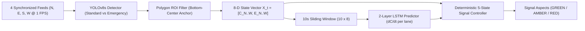
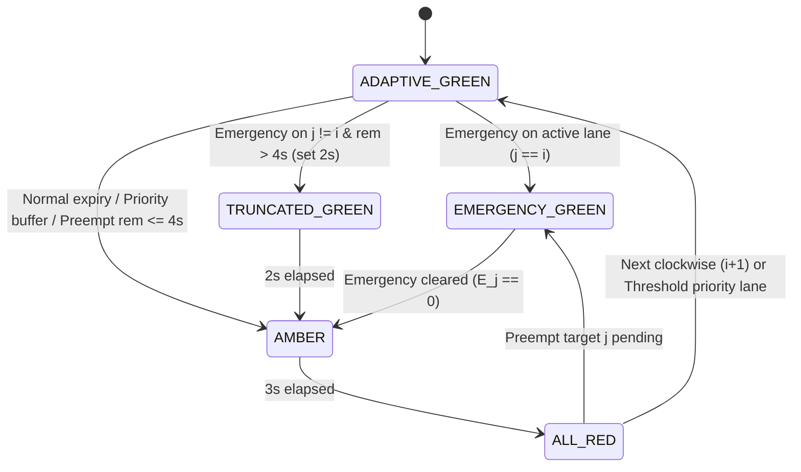

# Adaptive Traffic Signal Control with Emergency Preemption

An end-to-end adaptive traffic signal control system for a four-way signalized intersection (`N`, `E`, `S`, `W`), combining **YOLOv8** vehicle and emergency detection, **2-layer LSTM** queue-growth forecasting, a **deterministic zero-ML 5-state signal controller** with buffered car-count priority and emergency preemption, a **FastAPI** WebSocket backend, and a **React + Three.js** 3D/2D operations console.


---

## Table of Contents

- [Quick Start & Included Models](#quick-start--included-models)
- [Part 1: Core Concepts & Algorithms](#part-1-core-concepts--algorithms)
  - [1.1 Synchronized 1 Hz Four-Way Sensing](#11-synchronized-1-hz-four-way-sensing)
  - [1.2 Two-Class Object Detection & Leak-Free Dataset Preparation](#12-two-class-object-detection--leak-free-dataset-preparation)
  - [1.3 Polygon ROI Filtering & State Vector Construction](#13-polygon-roi-filtering--state-vector-construction)
  - [1.4 Sliding-Window LSTM Queue-Growth Forecasting](#14-sliding-window-lstm-queue-growth-forecasting)
  - [1.5 Decoupling ML Perception from Safety-Critical Control](#15-decoupling-ml-perception-from-safety-critical-control)
  - [1.6 Dynamic Adaptive Green Timing](#16-dynamic-adaptive-green-timing)
  - [1.7 Threshold-Gated Buffered Car-Count Priority](#17-threshold-gated-buffered-car-count-priority)
  - [1.8 Five-State Emergency Vehicle Preemption](#18-five-state-emergency-vehicle-preemption)
  - [1.9 Counterfactual Baseline Evaluation & 3D Digital Twin](#19-counterfactual-baseline-evaluation--3d-digital-twin)
- [Part 2: File-by-File Reference (How Each File Works)](#part-2-file-by-file-reference-how-each-file-works)
  - [2.1 Repository Structure](#21-repository-structure)
  - [2.2 Root Workspace Files](#22-root-workspace-files)
  - [2.3 Configuration Files (`traffic_signal_ml/configs/`)](#23-configuration-files-traffic_signal_mlconfigs)
  - [2.4 Data Pipeline (`traffic_signal_ml/src/dat/`)](#24-data-pipeline-traffic_signal_mlsrcdat)
  - [2.5 Object Detection (`traffic_signal_ml/src/detection/`)](#25-object-detection-traffic_signal_mlsrcdetection)
  - [2.6 Spatial Feature Extraction (`traffic_signal_ml/src/features/`)](#26-spatial-feature-extraction-traffic_signal_mlsrcfeatures)
  - [2.7 Video & RTSP Feed Ingestion (`traffic_signal_ml/src/feeds/`)](#27-video--rtsp-feed-ingestion-traffic_signal_mlsrcfeeds)
  - [2.8 LSTM Queue-Growth Prediction (`traffic_signal_ml/src/prediction/`)](#28-lstm-queue-growth-prediction-traffic_signal_mlsrcprediction)
  - [2.9 Deterministic Signal Control (`traffic_signal_ml/src/control/`)](#29-deterministic-signal-control-traffic_signal_mlsrccontrol)
  - [2.10 Simulation & Evaluation (`traffic_signal_ml/src/sim/` & `src/evaluation/`)](#210-simulation--evaluation-traffic_signal_mlsrcsim--srcevaluation)
  - [2.11 Backend Server, CLI & Streamlit (`traffic_signal_ml/`)](#211-backend-server-cli--streamlit-traffic_signal_ml)
  - [2.12 Automated Tests & Pre-trained Artifacts (`traffic_signal_ml/tests/` & `artifacts/`)](#212-automated-tests--pre-trained-artifacts-traffic_signal_mltests--artifacts)
  - [2.13 React + Three.js Frontend (`frontend/`)](#213-react--threejs-frontend-frontend)

---

## Quick Start & Included Models

Pre-trained weights and 3-minute synchronized demo videos are included directly in the repository—**no dataset download or model training is required after cloning**:

- **YOLOv8s Detector**: `traffic_signal_ml/artifacts/detector_best.pt` (`mAP50 = 0.920` overall; `0.970` on emergency vehicles)
- **2-Layer LSTM Predictor**: `traffic_signal_ml/artifacts/lstm_predictor.pt` (`Val MSE = 0.394`, `Test MAE = 0.423 veh/s`)
- **Synchronized 4-Way Demo Feeds**: `traffic_signal_ml/artifacts/demo_videos/approach_{N,E,S,W}.mp4` (`640x480`, `180s`)

### 1. Run Frontend + Backend Together
```powershell
# Install Node dependencies (root + frontend)
npm install
cd frontend && npm install && cd ..

# Launch FastAPI (port 8000) and Vite React UI (port 5173) concurrently
npm run dev
```
- **Live Camera Console**: `http://localhost:5173/` (streams real-time YOLOv8 + LSTM + Controller telemetry from `ws://localhost:8000/ws/traffic`)
- **Interactive 3D/2D Simulation**: `http://localhost:5173/simulation` (runs standalone in the browser with Three.js)

### 2. Run Backend, CLI Modes, or Tests Individually
```powershell
# FastAPI server only
.\.venv\Scripts\python.exe -m uvicorn src.server.api:app --app-dir traffic_signal_ml --host 127.0.0.1 --port 8000

# 1,800s simulation benchmark (Adaptive + Preemption vs. 30s Fixed Baseline)
.\.venv\Scripts\python.exe traffic_signal_ml/main.py --mode sim

# Headless 4-camera video pipeline
.\.venv\Scripts\python.exe traffic_signal_ml/main.py --mode video --max-ticks 60

# Backend pytest suite & frontend linter
.\.venv\Scripts\pytest.exe traffic_signal_ml/tests -v
cd frontend && npm run lint
```

---

# Part 1: Core Concepts & Algorithms

This part explains the computer vision, time-series forecasting, traffic engineering, and software architecture principles behind the system, independent of individual source files.



### 1.1 Synchronized 1 Hz Four-Way Sensing
- **Protected 4-Phase Chowk Geometry**: The intersection models a standard four-approach left-hand Indian *chowk* (`North`, `East`, `South`, `West`). Only one approach receives a protected `GREEN` phase at a time while the other three hold `RED`, cycling clockwise (`N -> E -> S -> W -> N`) under normal conditions.
- **Lockstep 1 FPS Sampling**: Signal phase durations operate on the scale of seconds (`2s–60s`), not milliseconds. Sampling all four approaches in lockstep at **1 Hz** ($\Delta t = 1.0\text{s}$) with a single shared timestamp eliminates inter-camera clock drift, keeps CPU/GPU inference lightweight, and aligns the perception loop (`X_t`), forecasting horizon (`dC/dt` in vehicles/second), and controller countdowns on the exact same 1-second time base.

### 1.2 Two-Class Object Detection & Leak-Free Dataset Preparation
- **Semantic Class Unification**: Signal control decisions depend on two distinct vehicle categories rather than fine-grained make/model taxonomies:
  - `0: standard_vehicle` — cars, SUVs, vans, buses, trucks, multi-axle lorries, motorcycles, scooters, and Indian auto-rickshaws/tempos.
  - `1: emergency_vehicle` — ambulances and fire engines.
- **Pseudo-Labeling Single-Class Sources**: Public ambulance datasets frequently annotate only the ambulance while leaving surrounding cars unlabeled—teaching a detector false negatives on regular traffic. During dataset unification, a pretrained COCO detector automatically pseudo-labels unannotated background vehicles (`IoU < 0.3` against ground-truth emergency boxes) so every training image has complete labels for both classes.
- **Group-Aware Leak-Free Splitting**: Roboflow datasets often include pre-augmented copies of the same base frame (`image_jpg.rf.<hash>.jpg` or `*_aug*`). Random image-level splitting leaks near-identical frames across train and test sets, artificially inflating mAP. The pipeline strips augmentation suffixes via regex to group all variants under their canonical source stem before performing a stratified `70% / 15% / 15%` split, ensuring `emergency_vehicle` examples appear in every split with zero data leakage.

### 1.3 Polygon ROI Filtering & State Vector Construction
- **Perspective Trapezoid ROI**: An approach camera sees sidewalks, parked vehicles, opposing outgoing lanes, and cross-street traffic. Counting every bounding box in the full frame would corrupt queue estimates. Each camera defines a perspective trapezoid polygon covering only **incoming approach lanes** upstream of the stop line.
- **Bottom-Center Ground-Plane Anchor**: Because tall vehicles (buses, trucks, ambulances) project upward in perspective views, using box centroids can place a vehicle outside its lane boundary. Instead, each box `[x1, y1, x2, y2]` is anchored at its **bottom-center tire contact point** $(0.5(x_1 + x_2),\, y_2)$ and tested via `cv2.pointPolygonTest`.
- **8-Dimensional State Vector**: Validated per-lane counts are packed at every second $t$ into:
  $$X_t = [C_N,\, C_E,\, C_S,\, C_W,\, E_N,\, E_E,\, E_S,\, E_W] \in \mathbb{R}^8$$
  where $C_\ell$ is the standard vehicle count and $E_\ell$ is the emergency vehicle count on approach $\ell \in \{N, E, S, W\}$.

### 1.4 Sliding-Window LSTM Queue-Growth Forecasting
- **Why Count Alone Is Insufficient**: Two approaches can both show $C = 6$ vehicles at second $t$, yet one queue may be shrinking rapidly while the other has a fast-arriving arterial platoon ($\frac{dC}{dt} > 0$). Incorporating predicted queue growth lets the controller allocate green time proactively before spillback occurs.
- **Architecture & Formulation**: An online circular buffer maintains the last $W = 10$ seconds of state vectors $X_{t-9:t} \in \mathbb{R}^{10 \times 8}$ (left-padded with $X_0$ during the initial warm-up seconds). A **2-layer PyTorch LSTM** (`input_size = 8`, `hidden_size = 64`, `num_layers = 2`) processes the sequence, and a linear head maps the final hidden state $h_t \in \mathbb{R}^{64}$ to predicted 1-second queue-change rates:
  $$\hat{y}_t = \left[\frac{\widehat{dC}_N}{dt},\, \frac{\widehat{dC}_E}{dt},\, \frac{\widehat{dC}_S}{dt},\, \frac{\widehat{dC}_W}{dt}\right] \in \mathbb{R}^4$$
- **Chronological Time-Series Splitting**: Unlike independent image classification, random shuffling of sliding windows leaks future trajectories into past training windows. Training strictly partitions time-series logs chronologically (`0–70%` train, `70–85%` validation, `85–100%` test).

### 1.5 Decoupling ML Perception from Safety-Critical Control
- **Zero-ML Control Boundary**: Neural networks are probabilistic and should never directly toggle physical traffic lamps, where conflicting greens or skipped clearance intervals cause collisions. In this architecture, ML models (`YOLOv8` and `LSTM`) output numerical estimates (`X_t` and `dC/dt`), while all phase transitions live inside a **pure deterministic state machine** with zero ML imports (enforced automatically via Python AST unit tests). Hard safety invariants—`3s` Amber, `1s` All-Red clearance, and `10s` Minimum Green—cannot be bypassed by model outputs.

### 1.6 Dynamic Adaptive Green Timing
During `ADAPTIVE_GREEN` on active lane $i$, the target green allocation is recomputed **every second** from live queue length $C_i$ and predicted growth $\widehat{dC}_i / dt$:

$$\text{target\_green}_i = \text{clamp}\!\left(\text{base\_green} + k_1 \cdot C_i + k_2 \cdot \max\!\left(\frac{\widehat{dC}_i}{dt},\, 0\right),\; \text{min\_green},\; \text{max\_green}\right)$$

- With defaults $\text{base\_green} = 15\text{s}$, $k_1 = 1.5\text{s/veh}$, $k_2 = 4.0\text{s}^2\text{/veh}$, $\text{min\_green} = 10\text{s}$, and $\text{max\_green} = 60\text{s}$:
  - Negative $\frac{dC}{dt}$ is floored at `0` so normal green-phase discharge does not prematurely collapse the timer.
  - Remaining phase time updates continuously as $\max(0,\, \text{target\_green}_i - \text{elapsed})$, contracting early once a platoon clears and extending up to `60s` under heavy inflow.

### 1.7 Threshold-Gated Buffered Car-Count Priority
To prevent unnecessary phase jumping during light or balanced traffic while still serving sudden heavy queues on red approaches:
1. **Threshold Gate (`car_count_priority_threshold = 10` cars)**: As long as every waiting approach has $C_\ell < 10$, priority switching remains completely dormant and the intersection rotates in normal clockwise order (`N -> E -> S -> W`).
2. **Sustained Hysteresis Buffer (`car_count_switch_buffer = 6s`)**: When a waiting approach reaches $C_j \ge 10$ (while the active green approach is below threshold, or exceeded by `margin = 5`), a buffer timer increments each second the condition holds continuously. Single-frame detection spikes reset the buffer to `0s`, preventing signal chatter.
3. **Safe Transition & Resumption**: Once both `min_green` (`10s`) and the `6s` buffer are satisfied, the controller executes standard `AMBER` (`3s`) $\rightarrow$ `ALL_RED` (`1s`) clearance before granting `ADAPTIVE_GREEN` to the priority approach $j$. Once all waiting queues drop back below `10`, normal clockwise cycling resumes. A `max_lane_red_wait` (`120s`) guard breaks ties if multiple approaches remain congested simultaneously.

### 1.8 Five-State Emergency Vehicle Preemption
Emergency preemption (`E_j > 0`) takes highest priority over both normal cycling and car-count priority, governed by five explicit states:



- **Same-Lane Emergency ($j = i$)**: Immediately enters `EMERGENCY_GREEN` on lane $i$ with zero interruption, holding green until $E_i = 0$.
- **Cross-Lane Emergency ($j \ne i$) with $> 4\text{s}$ Remaining**: Enters `TRUNCATED_GREEN` (`2s`) to warn moving drivers rather than slamming straight to yellow, followed by `AMBER` (`3s`) $\rightarrow$ `ALL_RED` (`1s`) $\rightarrow$ `EMERGENCY_GREEN` on lane $j$.
- **Cross-Lane Emergency ($j \ne i$) with $\le 4\text{s}$ Remaining**: Allows the remaining $\le 4\text{s}$ of green to finish naturally before `AMBER` (`3s`) $\rightarrow$ `ALL_RED` (`1s`) $\rightarrow$ `EMERGENCY_GREEN` on lane $j$, avoiding extending green rather than shortening it.
- **Deterministic Clockwise Resume**: Before preemption begins, the controller saves `resume_clockwise_index = (i + 1) % 4`. Once $E_j = 0$, lane $j$ clears safely through `AMBER` (`3s`) $\rightarrow$ `ALL_RED` (`1s`) and resumes at phase $(i + 1)$ so skipped approaches are never starved.

### 1.9 Counterfactual Baseline Evaluation & 3D Digital Twin
- **Paired Identical-Arrival Benchmarking**: Evaluating traffic controllers fairly requires subjecting both controllers to the **exact same vehicle arrival timestamps** and saturation discharge physics (`1.5 veh/s`, `3s` Amber, `1s` All-Red). Over a 30-minute (`1,800s`) seeded trace with bursty platoons and 11 emergency arrivals, Adaptive + Preemption reduced average wait time by **63.8%** (`150.4s -> 54.5s`), wasted idle green by **43.2%**, and emergency time-to-green by **86.4%** (`38.1s -> 5.2s`) compared to a `30s` Fixed-Timer baseline.
- **60 FPS Three.js Digital Twin**: While the control state machine steps discretely at `1 Hz`, the frontend Three.js scene interpolates vehicle positions smoothly at `60 FPS` using pre-allocated mesh pools (avoiding garbage-collection stalls), dynamic signal point lights, emissive stop-bar strips, ambulance strobe beacons, and automatic `ResizeObserver` / WebGL context lifecycle management, with a 1-click orthographic 2D SVG schematic mode.

---

# Part 2: File-by-File Reference (How Each File Works)

This part documents the exact role, inputs, and outputs of every file in the repository.

### 2.1 Repository Structure

```text
Traffic-management/
├── package.json                          # Root scripts to run FastAPI + Vite concurrently
├── requirements.txt                      # Root Python environment lockfile
├── .env.example                          # Template for ROBOFLOW_API_KEY
├── .gitignore                            # Git exclusions (keeps detector_best.pt & lstm_predictor.pt)
├── traffic_signal_ml/                    # Python ML, simulation, and FastAPI backend
│   ├── main.py                           # CLI entry point (--mode sim | --mode video)
│   ├── requirements.txt                  # Backend Python dependencies
│   ├── configs/                          # YAML configs (classes, datasets, lanes, controller, feeds)
│   ├── artifacts/                        # Pre-trained YOLO/LSTM weights, CSV logs, 4-way demo MP4s
│   ├── src/
│   │   ├── dat/                          # Dataset download, class inspection, label unification, splits
│   │   ├── detection/                    # YOLOv8 training & inference wrapper (with synthetic fallback)
│   │   ├── features/                     # Polygon ROI filtering & 8-D X_t vector construction/logging
│   │   ├── feeds/                        # Lockstep 1 FPS VideoFileFeed & live network RTSPFeed
│   │   ├── prediction/                   # Sliding-window dataset, 2-layer PyTorch LSTM, online predictor
│   │   ├── control/                      # Zero-ML 5-state machine & controller wrapper
│   │   ├── sim/                          # Poisson burst generator, queue physics, 30s fixed baseline
│   │   ├── evaluation/                   # Wait/idle/throughput/emergency metrics & side-by-side runner
│   │   ├── server/                       # FastAPI REST + WebSocket (/ws/traffic) live server
│   │   └── dashboard/                    # Standalone Streamlit 4-camera inspection dashboard
│   └── tests/                            # Pytest unit & integration suites
└── frontend/                             # React 19 + Vite + Three.js operations UI
    ├── index.html                        # HTML entry loading DM Sans typography
    ├── package.json                      # Frontend dependencies (React, Three.js, Lucide, Oxlint)
    ├── vite.config.js                    # Vite bundler config
    └── src/
        ├── main.jsx                      # React DOM root mount
        ├── index.css                     # Dark slate CSS variables & base reset
        ├── App.jsx / App.css             # History API router (/ and /simulation) & shared workspace layout
        ├── simulation/stateMachine.js    # Client-side ES module port of controller + 1s simulator
        ├── components/                   # ThreeIntersectionScene.jsx (3D WebGL) & IntersectionDiagram.jsx (2D SVG)
        └── pages/                        # LiveDashboard.jsx (/) & SimulationPage.jsx (/simulation)
```

---

### 2.2 Root Workspace Files

| File | How It Works |
| :--- | :--- |
| [package.json](package.json) | Defines root Node helper scripts using `concurrently` and `nodemon`: `npm run dev:backend` launches Uvicorn on `127.0.0.1:8000` watching `traffic_signal_ml/src`, `npm run dev:frontend` starts Vite in `frontend/`, and `npm run dev` runs both together. |
| [requirements.txt](requirements.txt) | Pinned Python package versions (`torch`, `ultralytics`, `opencv-python`, `fastapi`/`starlette`, `uvicorn`, `streamlit`, `pytest`, `yt-dlp`, etc.) for `.venv`. |
| [.env.example](.env.example) | Template showing `ROBOFLOW_API_KEY=...`, required only if re-downloading raw training datasets via `src/dat/download.py`. |
| [.gitignore](.gitignore) | Ignores `.venv/`, `node_modules/`, raw datasets, and intermediate training runs while explicitly tracking `!traffic_signal_ml/artifacts/detector_best.pt` and `!traffic_signal_ml/artifacts/lstm_predictor.pt` so clones work out of the box. |

---

### 2.3 Configuration Files (`traffic_signal_ml/configs/`)

| File | How It Works |
| :--- | :--- |
| [class_map.yaml](traffic_signal_ml/configs/class_map.yaml) | Maps 60+ raw dataset label strings (cars, trucks, buses, two-wheelers, auto-rickshaws, ambulances, fire trucks) into `{0: standard_vehicle, 1: emergency_vehicle}`. Unlisted labels are discarded during unification. |
| [datasets.yaml](traffic_signal_ml/configs/datasets.yaml) | Lists the Roboflow Universe projects/versions to download, `70 / 15 / 15` split ratios, `pseudo_label_standard` flags, and YOLOv8 hyperparameters (`model_variant: "yolov8s"`, `conf_threshold: 0.25`, `iou_threshold: 0.45`, `weights_path: "artifacts/detector_best.pt"`). |
| [lanes.yaml](traffic_signal_ml/configs/lanes.yaml) | Defines frame dimensions (`640x480`), bounding-box anchor mode (`bottom_center`), CSV log path, and the 4-vertex pixel ROI polygon (`[[120,80], [520,80], [600,460], [40,460]]`) for approaches `N`, `E`, `S`, and `W`. |
| [controller.yaml](traffic_signal_ml/configs/controller.yaml) | Central tuning file for phase order (`N, E, S, W`), adaptive green constants (`base_green: 15`, `k1: 1.5`, `k2: 4.0`, `min_green: 10`, `max_green: 60`), intergreen clearances (`amber: 3s`, `all_red: 1s`), preemption thresholds (`4s` / `2s`), car-count priority (`threshold: 10`, `buffer: 6s`, `margin: 5`, `max_lane_red_wait: 120s`), LSTM hyperparameters, and simulation duration (`1800s`). |
| [feeds.yaml](traffic_signal_ml/configs/feeds.yaml) | Selects `"video"` mode (reads local MP4s from `artifacts/demo_videos/`) or `"rtsp"` mode (connects to four live `rtsp://` or `http(s)://` camera stream URLs at `target_fps: 1.0`). |

---

### 2.4 Data Pipeline (`traffic_signal_ml/src/dat/`)

| File | How It Works |
| :--- | :--- |
| [download.py](traffic_signal_ml/src/dat/download.py) | Reads `ROBOFLOW_API_KEY` from `.env` and downloads each YOLOv8-formatted dataset specified in `configs/datasets.yaml` into `data/raw/` with retry handling. |
| [check_class.py](traffic_signal_ml/src/dat/check_class.py) | Diagnostic visual auditing script: renders bounding boxes of any ambiguous raw dataset class onto sample images in `check_out/` alongside reference ambulance boxes so class mappings in `class_map.yaml` can be verified before training. |
| [unify_labels.py](traffic_signal_ml/src/dat/unify_labels.py) | Iterates through `data/raw/`, normalizes class names (ignoring case, spaces, hyphens, and underscores), rewrites YOLO `.txt` annotations to class IDs `0` and `1`, runs `yolov8n.pt` on single-class ambulance datasets (`pseudo_label_standard: true`) to backfill unlabeled standard vehicles, and outputs clean image/label pairs to `data/unified/`. |
| [build_splits.py](traffic_signal_ml/src/dat/build_splits.py) | Strips `.rf.<hash>` and `_aug*` suffixes from filenames to group augmented variants under their original image, stratifies emergency vs. standard-only groups separately across `train`, `val`, and `test`, copies files into `data/splits/`, and writes `data/splits/data.yaml` for Ultralytics. |

---

### 2.5 Object Detection (`traffic_signal_ml/src/detection/`)

| File | How It Works |
| :--- | :--- |
| [train_yolo.py](traffic_signal_ml/src/detection/train_yolo.py) | Loads `YoloTrainConfig`, trains `yolov8n` or `yolov8s` on `data/splits/data.yaml`, copies the best checkpoint to `artifacts/detector_best.pt`, runs validation on the held-out `test` split, and exports overall and per-class Precision, Recall, `mAP50`, and `mAP50-95` to `artifacts/detector_test_metrics.json`. |
| [detector.py](traffic_signal_ml/src/detection/detector.py) | Production inference wrapper (`Detector`). Loads `artifacts/detector_best.pt` via Ultralytics `YOLO` and exposes `.detect(frame) -> DetectionOutput(boxes, class_ids, confidences)` filtered strictly to classes `{0, 1}`. Includes an OpenCV HSV/BGR contour fallback (`_detect_synthetic_markers`) if weights are absent during synthetic unit tests. |

---

### 2.6 Spatial Feature Extraction (`traffic_signal_ml/src/features/`)

| File | How It Works |
| :--- | :--- |
| [lane_density.py](traffic_signal_ml/src/features/lane_density.py) | Loads per-lane polygons (`LaneConfig`), computes each bounding box's `bottom_center` or `center` pixel anchor (`compute_box_anchor`), tests polygon inclusion (`point_in_polygon`), and counts standard and emergency vehicles inside each approach ROI (`count_vehicles_in_lane`), with optional polygon-area normalization. |
| [feature_vector.py](traffic_signal_ml/src/features/feature_vector.py) | Combines the four `LaneCounts` objects at timestamp $t$ into `FeatureVectorRecord` holding the 8-element `float32` vector `X_t = [C_N, C_E, C_S, C_W, E_N, E_E, E_S, E_W]`, and provides `FeatureCSVLogger` to stream every tick to `artifacts/feature_vectors_xt.csv`. |

---

### 2.7 Video & RTSP Feed Ingestion (`traffic_signal_ml/src/feeds/`)

| File | How It Works |
| :--- | :--- |
| [base.py](traffic_signal_ml/src/feeds/base.py) | Defines `LANES = ("N", "E", "S", "W")` and the abstract `FeedSource` iterator interface yielding `(shared_timestamp_sec, {'N': frame_N, 'E': frame_E, 'S': frame_S, 'W': frame_W})`. |
| [video_file_feed.py](traffic_signal_ml/src/feeds/video_file_feed.py) | Implements `VideoFileFeed`, opening four OpenCV `VideoCapture` handles (`approach_N/E/S/W.mp4`), mapping each 1-second tick to `round(timestamp * source_fps)` so videos of any native framerate stay locked in time, and includes `generate_synthetic_four_way_videos` / `ensure_demo_videos` when `demo_videos/` is empty. |
| [rtsp_feed.py](traffic_signal_ml/src/feeds/rtsp_feed.py) | Implements `RTSPFeed` for live network cameras (`rtsp://`, `rtsps://`, `http://`, `https://`), validating URLs, pacing reads at `target_fps`, and automatically reconnecting dropped streams within `reconnect_timeout_sec`. |

---

### 2.8 LSTM Queue-Growth Prediction (`traffic_signal_ml/src/prediction/`)

| File | How It Works |
| :--- | :--- |
| [dataset.py](traffic_signal_ml/src/prediction/dataset.py) | Computes 1-second forward queue-change targets `dC/dt = C_{t+1} - C_t` from `(T, 8)` `X_t` trajectories, slices causal `(M, W, 8)` sliding windows (`W = 10`), and wraps them in a PyTorch `QueueGrowthDataset` (supporting CSV loading via `.from_csv`). |
| [lstm_model.py](traffic_signal_ml/src/prediction/lstm_model.py) | Defines `QueueGrowthLSTM` (`nn.LSTM(8, 64, num_layers=2, batch_first=True)` + `nn.Linear(64, 4)`) and `OnlineQueuePredictor`, which maintains a `deque(maxlen=10)` during live operation, left-pads during the first 9 ticks, and runs `torch.no_grad()` inference each second. |
| [train_lstm.py](traffic_signal_ml/src/prediction/train_lstm.py) | Trains `QueueGrowthLSTM` with Adam + MSELoss on real `feature_vectors_xt.csv` logs (if sufficiently long) or a 3,000-step synthetic traffic trace using a strict chronological `70 / 15 / 15` split, saving best validation weights to `artifacts/lstm_predictor.pt` and metrics to `artifacts/lstm_predictor.metrics.json`. |

---

### 2.9 Deterministic Signal Control (`traffic_signal_ml/src/control/`)

| File | How It Works |
| :--- | :--- |
| [state_machine.py](traffic_signal_ml/src/control/state_machine.py) | Pure-Python deterministic core (zero ML/CV imports). Defines `SignalState`, `LightColor`, `StateMachineConfig`, `compute_adaptive_green`, and `PreemptionStateMachine`, executing the 1-second adaptive green update, threshold-gated buffered car-count priority (`>= 10` cars + `6s` buffer), all three emergency preemption branches (`j == i`, `rem > 4s` truncate, `rem <= 4s` normal expiry), clearance intervals, and `(i + 1)` clockwise resumption. |
| [controller.py](traffic_signal_ml/src/control/controller.py) | High-level `TrafficSignalController` facade wrapping `PreemptionStateMachine`. Validates 8-D `x_t` and 4-D `predicted_dc_dt` inputs, advances the state machine, incrementally flushes new `TransitionLog` entries to `artifacts/controller_transitions.csv`, and returns an immutable `ControllerDecision` snapshot. |

---

### 2.10 Simulation & Evaluation (`traffic_signal_ml/src/sim/` & `src/evaluation/`)

| File | How It Works |
| :--- | :--- |
| [synthetic_traffic.py](traffic_signal_ml/src/sim/synthetic_traffic.py) | Generates reproducible seeded `TrafficTrace` arrivals over 1,800s with asymmetric arterial vs. cross-street Poisson rates, 240-second platoon burst/lull waves, and stochastic emergency vehicle arrivals; also generates synthetic `X_t` trajectories for LSTM fallback training. |
| [baseline_fixed.py](traffic_signal_ml/src/sim/baseline_fixed.py) | Implements `FixedTimerBaselineController`, cycling clockwise `N -> E -> S -> W` with a static `30s` green, `3s` amber, and `1s` all-red interval and no preemption. |
| [intersection_sim.py](traffic_signal_ml/src/sim/intersection_sim.py) | Discrete 1-second queueing engine (`run_adaptive_simulation` and `run_fixed_baseline_simulation`). Tracks individual vehicle arrival timestamps in FIFO deques, discharges vehicles on green at `saturation_discharge_rate` (`1.5 veh/s`) with fractional carry-over, tracks idle green seconds (green with empty queue), records emergency arrival-to-green latency, and returns `SimulationRunResult`. |
| [metrics.py](traffic_signal_ml/src/evaluation/metrics.py) | Computes `EvaluationMetrics` from `SimulationRunResult`: mean vehicle wait time (`s`), wasted idle green time (`s`), total throughput (`vehicles`), and mean emergency time-to-green (`s`). |
| [compare.py](traffic_signal_ml/src/evaluation/compare.py) | Parses `configs/controller.yaml`, runs both Adaptive+Preemption and Fixed-Timer controllers over the exact same `TrafficTrace`, writes `artifacts/sim_comparison.csv`, and returns a comparison DataFrame. |

---

### 2.11 Backend Server, CLI & Streamlit (`traffic_signal_ml/`)

| File | How It Works |
| :--- | :--- |
| [src/server/api.py](traffic_signal_ml/src/server/api.py) | FastAPI backend (`TrafficEngine`). Initializes `Detector`, `OnlineQueuePredictor`, `TrafficSignalController`, and `VideoFileFeed` / `RTSPFeed`. At each step, runs YOLOv8 across all 4 frames, draws ROI polygons and bounding boxes, encodes JPEG frames as Base64, steps the LSTM + controller, and serves `GET /api/health`, `GET /api/state`, `POST /api/step`, `POST /api/reset`, and the live 1 Hz WebSocket stream `WS /ws/traffic`. |
| [main.py](traffic_signal_ml/main.py) | Command-line runner supporting `--mode sim` (runs `compare.py` benchmark and prints comparison table) and `--mode video` (runs the 4-camera YOLOv8 $\rightarrow$ ROI $\rightarrow$ $X_t$ $\rightarrow$ LSTM $\rightarrow$ Controller pipeline in terminal and logs CSVs). |
| [src/dashboard/app.py](traffic_signal_ml/src/dashboard/app.py) | Alternative standalone Python UI built with Streamlit for inspecting the 4 annotated camera feeds, $X_t$ metrics, predicted $dC/dt$, and transition logs without Node/React. |

---

### 2.12 Automated Tests & Pre-trained Artifacts (`traffic_signal_ml/tests/` & `artifacts/`)

| File / Path | How It Works |
| :--- | :--- |
| [test_state_machine.py](traffic_signal_ml/tests/test_state_machine.py) | Verifies zero ML imports in `src/control/` via AST parsing, adaptive green min/max clamping, clockwise cycling, `> 4s` truncation vs. `<= 4s` expiry preemption branches, below-threshold normal rotation, `>= 10` car threshold + `6s` buffer priority switching, starvation tie-breaking, and preemption override of pending count buffers. |
| [test_features_and_feeds.py](traffic_signal_ml/tests/test_features_and_feeds.py) | Tests bounding-box anchor math, polygon ROI inclusion/exclusion, area normalization, 8-D `X_t` ordering, CSV logging, and lockstep 4-camera `VideoFileFeed` iteration. |
| [test_prediction_and_sim.py](traffic_signal_ml/tests/test_prediction_and_sim.py) | Tests sliding-window target generation, `QueueGrowthLSTM` tensor shapes, cold-start padding in `OnlineQueuePredictor`, and superiority of Adaptive+Preemption over Fixed-Timer in simulation. |
| [test_rtsp_feed.py](traffic_signal_ml/tests/test_rtsp_feed.py) | Tests `RTSPFeed` URL validation, frame reading, error handling, and automatic stream reconnection using mocked OpenCV capture handles. |
| `traffic_signal_ml/artifacts/` | Stores `detector_best.pt` (trained YOLOv8s), `detector_test_metrics.json`, `lstm_predictor.pt` (trained 2-layer LSTM), `lstm_predictor.metrics.json`, `sim_comparison.csv`, `controller_transitions.csv`, `feature_vectors_xt.csv`, and `demo_videos/approach_{N,E,S,W}.mp4`. |

---

### 2.13 React + Three.js Frontend (`frontend/`)

| File | How It Works |
| :--- | :--- |
| [index.html](frontend/index.html) & [vite.config.js](frontend/vite.config.js) | HTML shell loading **DM Sans** from Google Fonts and Vite build configuration with `@vitejs/plugin-react`. |
| [src/main.jsx](frontend/src/main.jsx) & [src/index.css](frontend/src/index.css) | Mounts `<App />` and defines the dark slate CSS custom properties (`--bg-canvas: #0b0d10`, `--bg-panel: #111419`, `--bg-elevated: #171b22`), signal state colors, spacing tokens, and `.num` tabular numeral styling. |
| [src/App.jsx](frontend/src/App.jsx) & [src/App.css](frontend/src/App.css) | Lightweight History API router switching cleanly between `Live` (`/`) and `Simulation` (`/simulation`), plus shared styles for the single `44px` top bar, edge-to-edge split workspace, signal indicators, and hairline approach rows. |
| [src/simulation/stateMachine.js](frontend/src/simulation/stateMachine.js) | Pure ES-module port of `PreemptionStateMachine`, `FixedTimerBaselineController`, `computeAdaptiveGreen`, and `IntersectionSimulator` (`step`, `reset`, `setDemandMode`, `setCarCountConfig`, `injectVehicles`, `injectEmergency`, `clearEmergency`, `getSnapshot`), enabling instant 1-second discrete simulation in the browser without backend latency. |
| [src/components/ThreeIntersectionScene.jsx](frontend/src/components/ThreeIntersectionScene.jsx) | Interactive Three.js WebGL 3D intersection scene with `OrbitControls`, `ISO / TOP / N-S / E-W` camera presets, `3D / 2D` view switcher, cantilever signal masts with dynamic `PointLight` road washes, pre-allocated car and ambulance mesh pools animated at 60 FPS, flashing ambulance beacons, projected `N / E / S / W` compass markers, and clean WebGL context lifecycle handling. |
| [src/components/IntersectionDiagram.jsx](frontend/src/components/IntersectionDiagram.jsx) | Orthographic 2D SVG schematic of the four-way junction showing corner signal housings, stop bars, queued cars/ambulances, overflow badges, and `ALL-RED` / `TRUNCATE` / `PREEMPT` center status indicators. |
| [src/pages/SimulationPage.jsx](frontend/src/pages/SimulationPage.jsx) & [SimulationPage.css](frontend/src/pages/SimulationPage.css) | Interactive `/simulation` workspace: houses transport controls (`Play/Pause`, `Step`, `Reset`, `0.5x–4x` speed, `Manual / Light / Normal / Rush hour` flow) in the top bar, renders `ThreeIntersectionScene` full-bleed on the left, and provides the live phase countdown, per-approach vehicle counts, `+5` / `Emg` / `Clear` triggers, and `Priority by count` (`Threshold` + `Buffer`) controls in the right sidebar. |
| [src/pages/LiveDashboard.jsx](frontend/src/pages/LiveDashboard.jsx) | Live camera console at `/`: connects to `ws://localhost:8000/ws/traffic` with auto-reconnect, provides `Pause / Resume`, `Step`, and `Reset` API controls in the top bar, renders the 2×2 annotated approach camera feeds (`North`, `East`, `South`, `West`) on the left, and displays live signal state, countdown, emergency status, and per-approach vehicle counts (`--` when offline) in the right sidebar. |
