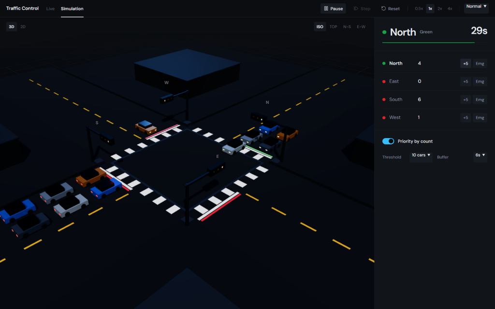

# Adaptive Traffic Signal Control with Emergency Preemption

A four-way intersection (`N`, `E`, `S`, `W`) signal controller combining YOLOv8 standard and emergency vehicle detection, 2-layer LSTM per-lane queue growth prediction (`dC/dt`), and a deterministic five-state signal controller (`ADAPTIVE_GREEN`, `TRUNCATED_GREEN`, `AMBER`, `ALL_RED`, `EMERGENCY_GREEN`) with buffered car-count switching and emergency vehicle preemption. The operations frontend provides both a live 4-camera WebSocket console (`/`) and an interactive discrete-time 3D/2D simulation console (`/simulation`).



## Pre-trained Models & Demo Feeds (Included)

Pre-trained model weights and synchronized 3-minute live demo feeds are committed directly to the repository so no dataset download or model training is required after cloning:
- **YOLOv8s Vehicle & Emergency Detector**: `traffic_signal_ml/artifacts/detector_best.pt` (`mAP50 = 0.920`, emergency `mAP50 = 0.970`)
- **2-Layer LSTM Queue Growth Predictor**: `traffic_signal_ml/artifacts/lstm_predictor.pt`
- **4-Approach Demo Feeds (`640x480`)**: `traffic_signal_ml/artifacts/demo_videos/approach_{N,E,S,W}.mp4`

## Running Locally

### 1. Backend (FastAPI + YOLOv8 + LSTM + Controller)

From the repository root, using the project Python environment:

```powershell
.\.venv\Scripts\python.exe -m uvicorn src.server.api:app --app-dir traffic_signal_ml --host 127.0.0.1 --port 8000
```

Or run both backend and frontend concurrently via the root script:

```powershell
npm run dev
```

### 2. Frontend (React + Vite + Three.js Console)

```powershell
cd frontend
npm install
npm run dev
```

Open `http://localhost:5173/` for the live camera operations console (requires the backend on port `8000`) or `http://localhost:5173/simulation` for the standalone discrete-time signal simulator.

## Detailed ML & Controller Documentation

See [`traffic_signal_ml/README.md`](traffic_signal_ml/README.md) for dataset specifications, model architecture, controller parameters, CLI simulation scripts, and pytest coverage.

## Suggested GitHub Repository Metadata

- **Description**: Adaptive 4-way traffic signal controller with YOLOv8 emergency vehicle preemption, LSTM queue growth forecasting, and a 3D/2D operations console.
- **Topics**: `traffic-signal-control`, `emergency-preemption`, `yolov8`, `lstm`, `fastapi`, `react`, `threejs`, `computer-vision`, `intelligent-transportation`
